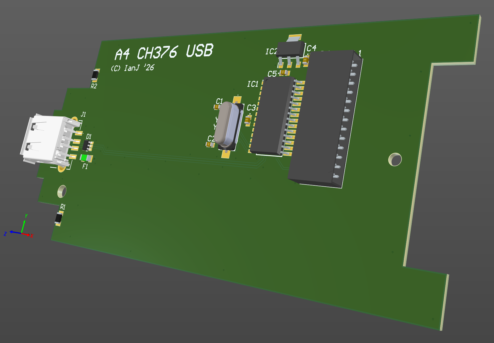

# Acorn A4 'USB' interface (FATFS memory sticks only)

October 2026

A simple hardware design for the Acorn A4 laptop, providing a USB memory stick (not generic USB) interface using the CH376.

The majority of parts can be lifted directly from cheaply available CH376 modules.   Additional input protection is added to the USB port.

This operates as expected with !USBFS - select any podule slot.

## Licence

No warranty is provided, and this work is used at your own risk.  

Licenced as CC BY-SA 4.0

Copyright 2026 Ian Jeffray
